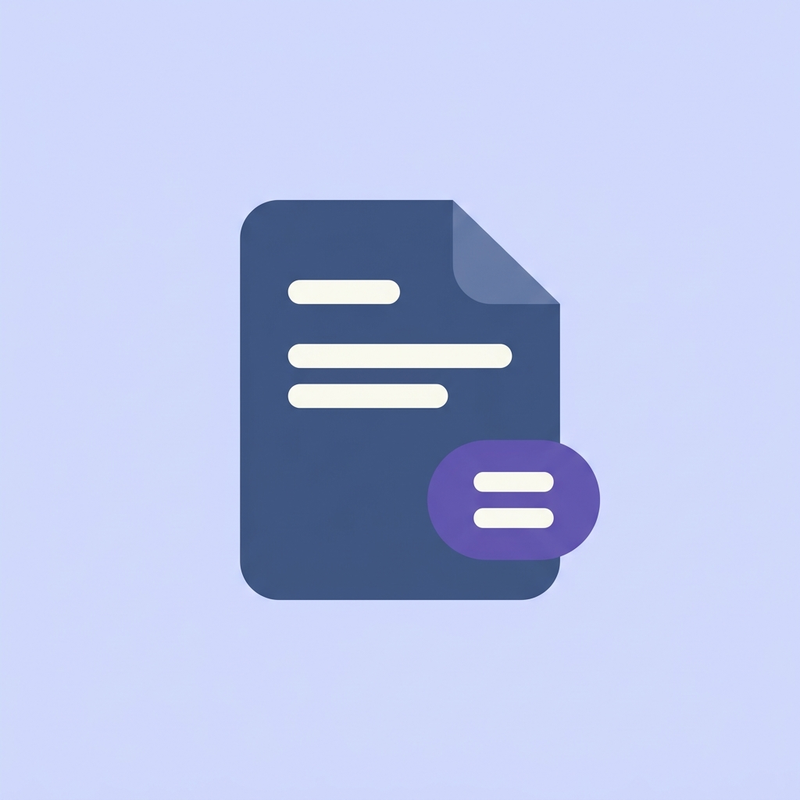

<p align="center">
  
</p>

<h1 align="center">Risalah Mobile</h1>

<p align="center">
  Aplikasi catatan offline-first bergaya <strong>Swiss Editorial</strong> berbasis React Native & Expo.
</p>

<p align="center">
  <a href="https://github.com/Shiroo001/Risalah---NoteTaking-Mobile-App/releases/latest">
    <strong>Download APK (Android)</strong>
  </a>
</p>

---

## Fitur Utama
- **Organisasi Catatan:** Pencarian instan, filter `#tag`, Pin/Unpin, drag-to-reorder 60fps, Archive terlindungi PIN 4 digit (`expo-secure-store`), dan Trash (restore / hapus permanen).
- **Editor WYSIWYG:** Bold, Italic, Underline, Strikethrough, tautan, 14 preset warna teks & highlight + custom HSV color picker, pilihan font & ukuran, perataan teks, checklist interaktif, dan daftar bersarang hingga 5 level.
- **Media & Alat:** Sisipkan foto galeri/kamera dan sketsa gambar bebas (auto-crop PNG) yang bisa diubah ukuran & digeser berdampingan, plus kalkulator pop-up.
- **5 Tema Swiss Editorial:** Swiss White, Warm Paper, Zurich Blue, Carbon Dark, dan Midnight Ink.
- **Backup & Sinkronisasi:** Ekspor/impor catatan `.json` dan sinkronisasi opsional ke backend PHP LAN.

## Download & Install (Android)
1. Buka halaman [**GitHub Releases**](https://github.com/Shiroo001/Risalah---NoteTaking-Mobile-App/releases/latest).
2. Unduh file `.apk` pada bagian **Assets**.
3. Buka file di HP Android dan izinkan *Install unknown apps* jika diminta.

## Tech Stack
- **Framework:** React Native 0.88 + Expo SDK 58 (Managed Workflow) + TypeScript
- **Storage & Security:** `@react-native-async-storage/async-storage`, `expo-secure-store`, `expo-file-system`
- **Rich Editor & Media:** `react-native-webview`, `expo-image-picker`, `react-native-svg`

## Menjalankan di Mode Pengembangan (Expo Go)
```powershell
npm.cmd install
npx.cmd expo start -c
```

## Verifikasi Lokal
```powershell
node scripts/verify-core.mjs
npx.cmd tsc --noEmit
```

## Build `.apk` Standalone (EAS Build)
```powershell
npx.cmd eas-cli login
npx.cmd eas-cli build -p android --profile preview
```
Profil `preview` di [`eas.json`](eas.json) menghasilkan file `.apk` siap pasang tanpa Expo Go.

## Dokumentasi
Spesifikasi produk tersimpan di [`docs/PRD.md`](docs/PRD.md).

## Lisensi
Dirilis di bawah lisensi [MIT](LICENSE).
